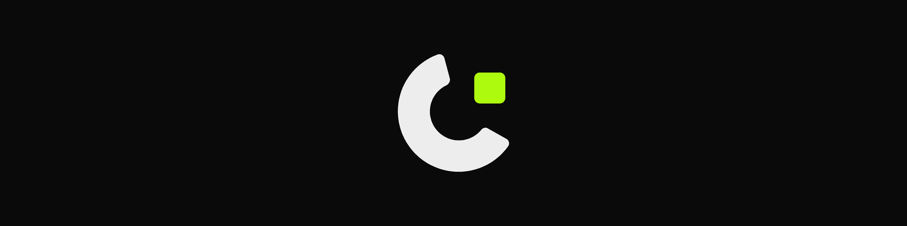
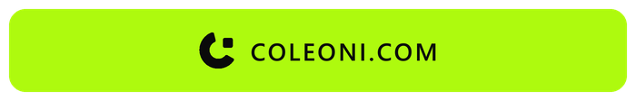
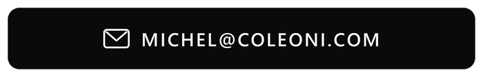
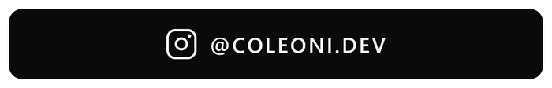
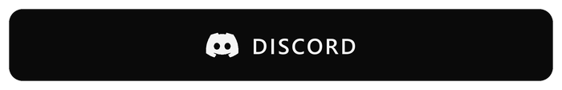

## About me

I design and build sites, systems and products end to end: the interface, the code, the server and what happens after launch. One person, the whole way.

Some of it is for clients, some is mine, and some you can use right now.

## Projects

<table>
<thead>
<tr>
<th align="left">Project</th>
<th align="left" width="43%">What it is</th>
<th align="left" width="31%">Stack</th>
</tr>
</thead>
<tbody>
<tr>
<td nowrap>&nbsp;<b><a href="https://skills.coleoni.com">Skills</a></b>&nbsp;</td>
<td>Free skills for Claude Code, Codex, Cursor and Gemini CLI: scopes, portfolio thumbnails, favicons, launch checks and more</td>
<td><kbd>Node.js</kbd> <kbd>Playwright</kbd> <kbd>SKILL.md</kbd></td>
</tr>
<tr>
<td nowrap>&nbsp;<b><a href="https://blob.coleoni.com">Blob Avatar</a></b>&nbsp;</td>
<td>Free animated avatar editor: pick a shape, a face and a few animations, then export PNG, GIF or SVG, or embed it with one tag</td>
<td><kbd>React</kbd> <kbd>TypeScript</kbd> <kbd>Vite</kbd> <kbd>Tailwind</kbd></td>
</tr>
<tr>
<td nowrap>&nbsp;<b><a href="https://loaders.coleoni.com">Loaders</a></b>&nbsp;</td>
<td>27 loading animations for React and plain HTML: pick one, tune it, copy the code</td>
<td><kbd>React</kbd> <kbd>TypeScript</kbd> <kbd>CSS</kbd> <kbd>npm</kbd></td>
</tr>
<tr>
<td nowrap>&nbsp;<b><a href="https://scanner.coleoni.com">Scanner</a></b></td>
<td>Free SEO scanner: paste a link, get a score from 0 to 100 and what to fix first</td>
<td><kbd>TypeScript</kbd> <kbd>Hono</kbd> <kbd>Postgres</kbd> <kbd>OpenAI</kbd></td>
</tr>
<tr>
<td nowrap>&nbsp;<b><a href="https://streak.coleoni.com">Streak</a></b></td>
<td>Free browser game: follow the green pixel, keep the streak going, play the daily challenge</td>
<td><kbd>TypeScript</kbd> <kbd>Canvas</kbd> <kbd>Hono</kbd> <kbd>Postgres</kbd></td>
</tr>
<tr>
<td nowrap>&nbsp;<b><a href="https://trimos.app">TrimOS</a></b></td>
<td>Management SaaS for barbershops: schedule, clients, services, billing and an AI assistant</td>
<td><kbd>React</kbd> <kbd>TypeScript</kbd> <kbd>Express</kbd> <kbd>MySQL</kbd></td>
</tr>
</tbody>
</table>

<!-- Nova linha: salve a logo 256x256 em assets/projects/ e copie o bloco <tr> acima. Guia: assets/projects/README.md -->

## Let's talk

